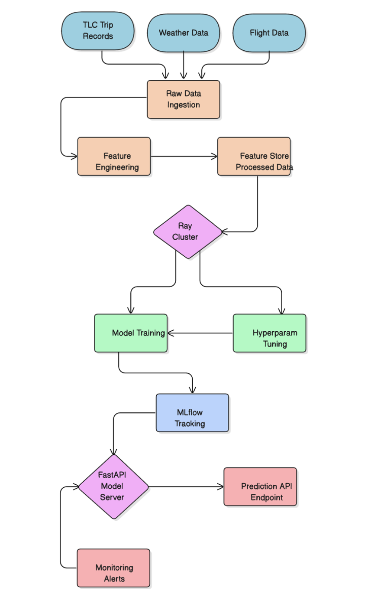
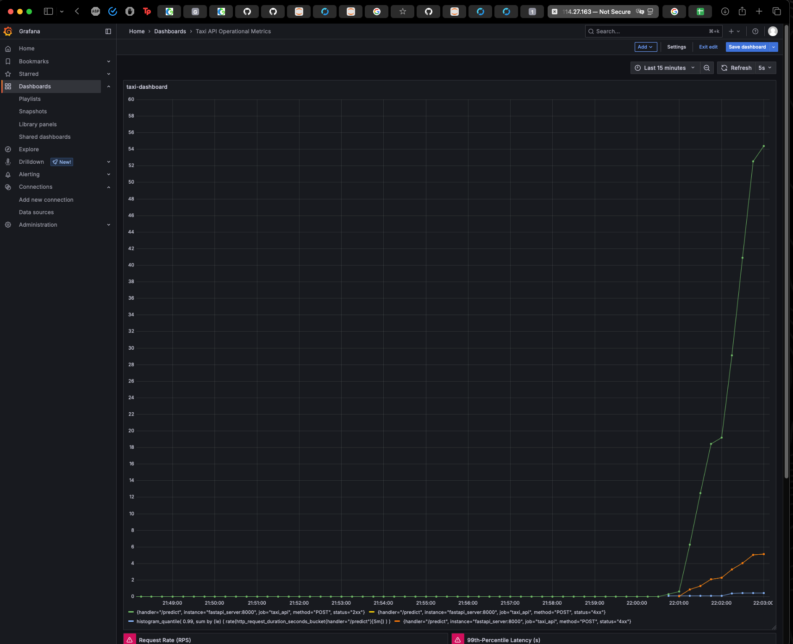
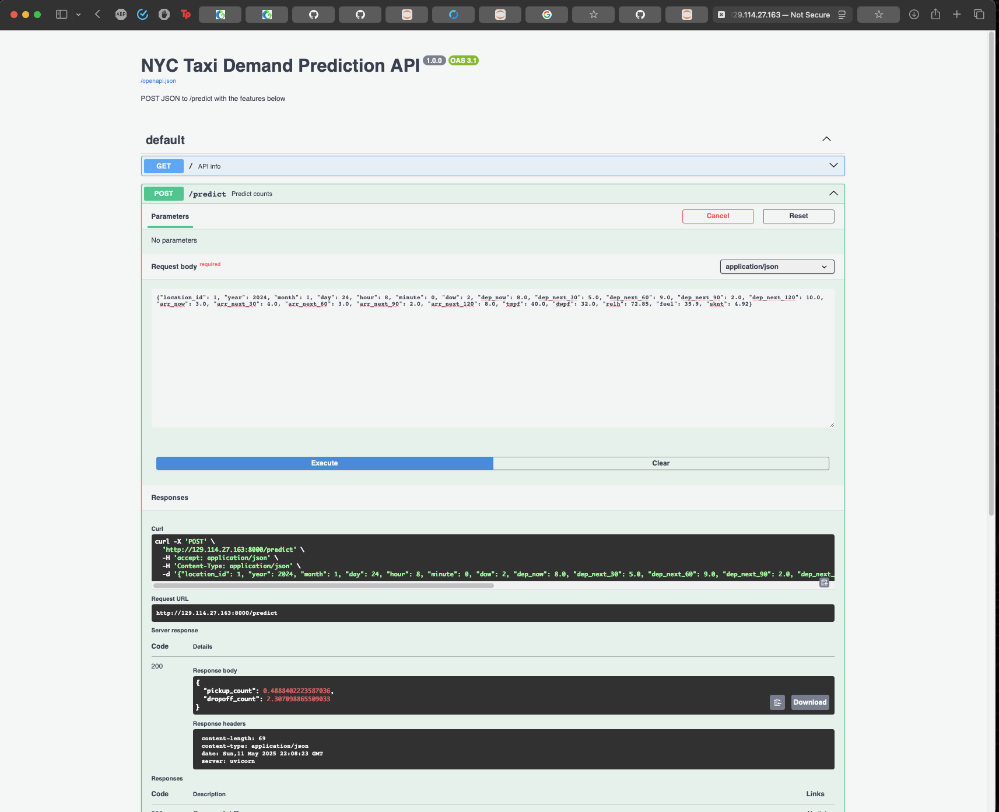
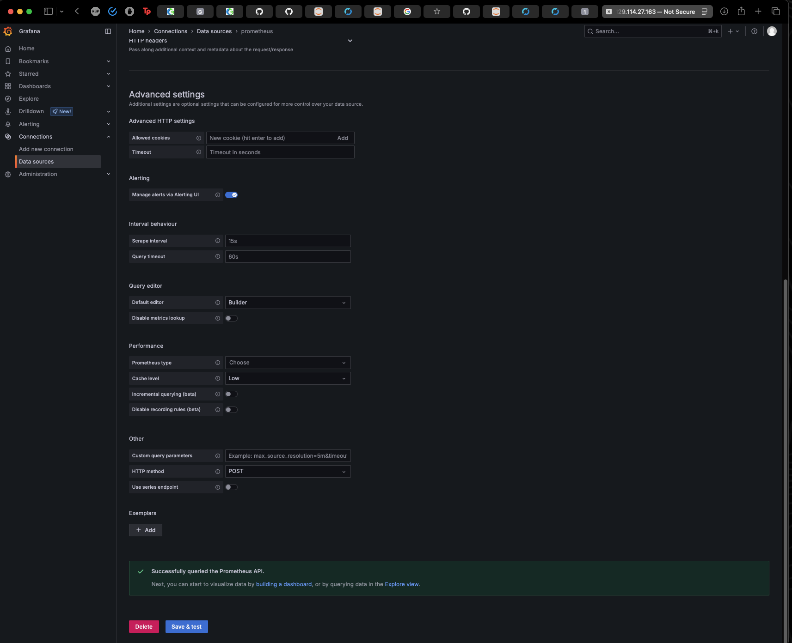

**NYC Taxi Demand Prediction with Weather and Flight Data Integration** 

**Value Proposition** 

**NYC Taxi Demand Prediction with Weather and Flight Data Integration** is a project aimed at improving urban mobility through better forecasting of taxi demand. Using historical NYC Taxi and Limousine Commission (TLC) trip records enriched with weather and flight arrival data, we will predict hourly taxi pickup counts in New York City. By anticipating surges or lulls in demand (for example, due to rain or incoming flights), taxi fleets and dispatchers can proactively allocate drivers, reducing passenger wait times and avoiding oversupply in low-demand periods. This leads to more efficient service for passengers and higher utilization for drivers, addressing urban transit needs.  

The business impact is significant i.e. better demand forecasts mean improved rider satisfaction and driver revenue, and city authorities can use these insights for traffic management. We will evaluate our models with Root Mean Square Error as the primary metric, to quantitatively measure prediction accuracy in number of trips. A lower RMSE on held-out data will indicate a better model, and this metric directly ties to business goals by representing how close our predictions are to actual taxi usage. 


# NYC Taxi Demand Prediction on Chameleon

An end‑to‑end MLOps pipeline—provision VMs, ingest & ETL data, train models, serve via FastAPI/Flask, schedule with Airflow, and monitor with Prometheus/Grafana.

---

## Table of Contents

0. [🗂️ Project Structure](#️-project-structure)
1. [🧪 Data Pipeline Overview](#-unit-8-data-pipeline)
2. [1️⃣ Launch & VM Setup](#1-launch--vm-setup)  
3. [2️⃣ Object Storage (MinIO)](#2-object-storage-minio)  
4. [3️⃣ Block Storage & ETL](#3-block-storage--etl)  
5. [4️⃣ Model Training & Offline Eval](#4-model-training--offline-eval)  
6. [5️⃣ FastAPI Inference & Metrics](#5-fastapi-inference--metrics)  
7. [6️⃣ Online Streaming Inference](#6-online-streaming-inference)  
8. [7️⃣ Airflow Orchestration](#7-airflow-orchestration)  
9. [8️⃣ Flask Production Service](#8-flask-production-service)  
10. [🧹 Cleanup](#-cleanup)  

---

## 🗂️ Project Structure

| Path | Contents |
|------|----------|
| `Docker/` | Dockerfiles and `docker-compose` definitions for every stage of the pipeline — ETL (`docker-compose-etl.yml`), block-storage Jupyter (`Dockerfile.jupyter-onnx-cpu/gpu`), FastAPI serving (`docker-compose-fastapi.yaml`), Prometheus (`docker-compose-prometheus.yaml`, `prometheus.yml`), and the production Flask service (`docker-compose-production.yaml`). Also holds CI/build/promote workflow configs (`build-container-image.yaml`, `promote-model.yaml`, `train-model.yaml`) and the Grafana dashboard definition `taxi_api_dashboard.json`. |
| `airflow/` | `docker-compose-airflow.yaml` plus the DAGs in `airflow/dags/` (`sample_for_labeling_dag.py`, `retrain_model_dag.py`, `predict_dag.py`, `fetch_labeled_and_evaluate_dag.py`) that schedule retraining and evaluation. |
| `ansible/` | Playbooks for provisioning and app delivery: `general/`, `pre_k8s/`, `k8s/` (Kubespray-based cluster bring-up), `post_k8s/`, and `argocd/` (ArgoCD app-of-apps for staging/canary/production/platform). |
| `k8s/` | Helm charts for the `staging`, `canary`, `production`, and `platform` deployments (each with `Chart.yaml`, `templates/`, `values.yaml`). |
| `fastapi_pt/` | The FastAPI inference service (`app.py`, `Dockerfile`, `requirements.txt`) that serves model predictions and exposes metrics. |
| `flask_app/` | The Flask production-facing demand-prediction UI (`app.py`, `templates/`, `static/`) used in the [Flask Production Service](#8-flask-production-service) step. |
| `streaming_pipeline/` | `stream_data.py`, which simulates real-time streaming inference against the deployed API. |
| `mlflow-server/` | `docker-compose.yml` / `docker-compose-block.yaml` for standing up the MLflow tracking server used during training. |
| `notebooks/` | Jupyter notebooks for model-serving experiments (`model_serving_xgb.ipynb`, `model_serving_rf.ipynb`) and Chameleon server creation (`create_server.ipynb`). |

Other top-level items: `tf/kvm` (Terraform for Chameleon KVM infra), `models/` and `flask_app/xgb_model_100.pth` (trained model artifacts), `data/taxi_zones.geojson` (reference geo data), and `run_etl.sh` (convenience wrapper for the ETL compose stack).

---
## 🧪 Unit 8: Data Pipeline

This section documents the complete lifecycle of our data handling and transformation processes—from offline batch ingestion to real-time simulation and inference—using a Dockerized ETL pipeline with persistent storage on **Chameleon Cloud**.

---

### 📦 Persistent Storage (Chameleon Volume)

We provisioned a persistent volume via Chameleon Cloud using `python-chi`. This volume is mounted at `/app/data` inside the container and stores:

- Raw data (taxi, flight, weather)
- Cleaned and engineered features
- Final merged training files
- Prediction results

This volume ensures data persistence across container restarts or rebuilds.

---

### 🏗️ Offline ETL Pipeline

Our Docker Compose–based ETL system automates the complete pipeline from raw data ingestion to structured training-ready datasets. All scripts are in the `/scripts` folder.

#### 🔽 1. Raw Data Extraction

**File:** `download_data.py`  
**Command:** `python3 download_data.py <year> <month>`

This script downloads:

- NYC Yellow and Green Taxi data from TLC
- Domestic flight performance data from BTS
- ASOS weather station data from Iowa Mesonet

It saves the cleaned monthly CSVs to `/app/data/taxi`, `/flight`, and `/weather`.

#### 🧹 2. Transformation

Each data domain is cleaned and engineered into structured features:

| Domain  | Script | Description |
|--------|--------|-------------|
| **Taxi** | `prepare_taxi_data.py` | Aggregates pickup/dropoff counts at JFK, LGA, and EWR every 15 minutes |
| **Flight** | `prepare_flight_data.py` | Aggregates flight departures/arrivals at NYC airports with future windows |
| **Weather** | `prepare_weather_data.py` | Resamples weather readings to 15-minute intervals with forward fill |

Each script outputs features as `*_features_<year>_<month>.csv`.

#### 🔀 3. Feature Merging

**File:** `merge_all_features.py`  
**Command:** `python3 merge_all_features.py <year> <month>`

This script merges the processed taxi, flight, and weather datasets into a unified training dataset keyed by:

Result is saved in `/app/data/output/final_features_<year>_<month>.csv`.

---

### ☁️ 4. Upload to Object Store

**File:** `upload_to_object_store.py`  
**Command:** `python3 upload_to_object_store.py <year> <month>`

Uploads merged training files to a remote **Chameleon object store** bucket using `rclone`. Bucket path:  
`chi_tacc:object-persist-project40/final_features_<year>_<month>.csv`

---

### 🔄 Docker Compose Workflow

**File:** `docker-compose-etl.yml`

Defines 6 services to automate the full ETL:

1. `extract-data`: Runs `download_data.py`
2. `transform-taxi`: Runs `prepare_taxi_data.py`
3. `transform-flight`: Runs `prepare_flight_data.py`
4. `transform-weather`: Runs `prepare_weather_data.py`
5. `merge-features`: Merges all features into final dataset
6. `load-data`: Uploads final dataset to object store

Each container shares `/data` and runs in dependency order.

---

### 📡 Online Streaming Inference

**File:** `stream_data.py`

Simulates real-time streaming inference for each 15-min interval using monthly merged feature files.

- Downloads monthly feature files from object store
- Sends each row to a local ML model API (via HTTP POST)
- Logs predictions and actuals to JSONL files in `/data/predictions`
- Uploads results back to object store

---

### 🧰 Requirements

Install all Python dependencies using:

```bash
pip install -r requirements.txt

## 1️⃣ Launch & VM Setup

Log into your Chameleon JupyterLab and in a new cell run:

```python
from chi import server, context
import os

# Configure & provision
context.version = "1.0"
context.choose_project()
context.choose_site(default="KVM@TACC")

username = os.getenv("USER")
s = server.Server(
    name=f"node-persist-{username}",
    image_name="CC-Ubuntu24.04",
    flavor_name="m1.xlarge"
)
s.submit(idempotent=True)
s.associate_floating_ip()
```
``` python
security_groups = [
    {"name":"allow-ssh",   "port":22,   "description":"SSH"},
    {"name":"allow-3000",  "port":3000, "description":"Ray dashboard"},
    {"name":"allow-5000",  "port":5000, "description":"Flask inference"},
    {"name":"allow-8000",  "port":8000, "description":"FastAPI / MLflow"},
    {"name":"allow-8080",  "port":8080, "description":"Custom service"},
    {"name":"allow-8081",  "port":8081, "description":"cAdvisor"},
    {"name":"allow-8888",  "port":8888, "description":"Jupyter"},
    {"name":"allow-9000",  "port":9000, "description":"MinIO API"},
    {"name":"allow-9001",  "port":9001, "description":"MinIO UI"},
    {"name":"allow-9090",  "port":9090, "description":"Prometheus UI"},
]

os_conn     = chi.clients.connection()
nova_server = os_conn.nova().servers.get(s.id)

for sg in security_groups:
    if not os_conn.get_security_group(sg["name"]):
        os_conn.create_security_group(sg["name"], sg["description"])
    os_conn.create_security_group_rule(
        sg["name"],
        port_range_min=sg["port"], port_range_max=sg["port"],
        protocol="tcp", remote_ip_prefix="0.0.0.0/0"
    )
    nova_server.add_security_group(sg["name"])
```
```python
ssh -i ~/.ssh/id_rsa_chameleon cc@A.B.C.D
```
```python
curl -sSL https://get.docker.com/ | sudo sh
sudo groupadd -f docker
sudo usermod -aG docker $USER
```

## 2️⃣ Object Storage (MinIO)
```bash
curl https://rclone.org/install.sh | sudo bash
sudo sed -i '/#user_allow_other/s/^#//' /etc/fuse.conf

mkdir -p ~/.config/rclone
cat <<EOF > ~/.config/rclone/rclone.conf
[chi_tacc]
type = swift
user_id = YOUR_USER_ID
application_credential_id = APP_CRED_ID
application_credential_secret = APP_CRED_SECRET
auth = https://chi.tacc.chameleoncloud.org:5000/v3
region = CHI@TACC
EOF
rclone lsd chi_tacc:
docker compose -f ~/NYC-Taxi-Demand-Prediction-with-Weather-and-Flight-Data-Integration/Docker/docker-compose-etl.yaml run extract-data
sudo mkdir /mnt/object
sudo chown cc:cc /mnt/object
rclone mount chi_tacc:object-persist-project40 /mnt/object \
    --read-only --allow-other --daemon
ls /mnt/object
```
## 3️⃣ Block Storage & ETL
 ```bash
lsblk           # find /dev/vdb
sudo mkfs.ext4 /dev/vdb1
sudo mkdir -p /mnt/block
sudo mount /dev/vdb1 /mnt/block
sudo chown cc:cc /mnt/block
df -h           # verify mount at /mnt/block
HOST_IP=$(curl -s http://169.254.169.254/latest/meta-data/public-ipv4)
docker compose -f ~/NYC-Taxi-Demand-Prediction-with-Weather-and-Flight-Data-Integration/Docker/docker-compose-block.yml up -d
http://<HOST_IP>:8888/?token=...

```   
## 4️⃣ Model Training & Offline Eval
 ```bash
python3 ~/NYC-Taxi-Demand-Prediction-with-Weather-and-Flight-Data-Integration/scripts/trains.py \
  --input-dir /mnt/block/data \
  --output-dir /mnt/block/model_artifacts \
  --mlflow-uri http://127.0.0.1:8000/

```
MLflow UI: http://<HOST_IP>:8000
MinIO UI: http://<HOST_IP>:9001

## 5️⃣ FastAPI Inference & Metrics
```bash
HOST_IP=$(curl -s http://169.254.169.254/latest/meta-data/public-ipv4)
docker compose -f ~/NYC-Taxi-Demand-Prediction-with-Weather-and-Flight-Data-Integration/Docker/docker-compose-fastapi.yaml up -d
docker compose -f ~/NYC-Taxi-Demand-Prediction-with-Weather-and-Flight-Data-Integration/Docker/docker-compose-prometheus.yaml up -d
```
Prometheus: http://<HOST_IP>:9090
FastAPI: http://<HOST_IP>:8000

## 6️⃣ Online Streaming Inference
 ```bash
python3 ~/NYC-Taxi-Demand-Prediction-with-Weather-and-Flight-Data-Integration/streaming_pipeline/stream_data.py
```
This will simulate live data, call /predict, and push results back to object store.

## 7️⃣ Airflow Orchestration
```bash
HOST_IP=$(curl -s http://169.254.169.254/latest/meta-data/public-ipv4)
docker compose -f ~/NYC-Taxi-Demand-Prediction-with-Weather-and-Flight-Data-Integration/airflow/docker-compose_airflow.yaml up -d
```

Airflow UI: http://<HOST_IP>:8080

## 8️⃣ Flask Production Service
```bash
HOST_IP=$(curl -s http://169.254.169.254/latest/meta-data/public-ipv4)
docker compose -f ~/NYC-Taxi-Demand-Prediction-with-Weather-and-Flight-Data-Integration/Docker/docker-compose-production.yaml up -d
```

Flask UI: http://<HOST_IP>:5000

**System Diagram** 

The diagram below shows the end-to-end system architecture, including data sources, the ETL pipeline, the training cluster, model registry, and the serving and monitoring components: 






## 🧹 Cleanup

When you're done, tear resources down in reverse order to avoid orphaned cloud charges:

```bash
# Stop the application stacks (run on the VM, from the repo root)
docker compose -f Docker/docker-compose-production.yaml down
docker compose -f airflow/docker-compose-airflow.yaml down
docker compose -f Docker/docker-compose-prometheus.yaml down
docker compose -f Docker/docker-compose-fastapi.yaml down
docker compose -f Docker/docker-compose-block.yml down
docker compose -f Docker/docker-compose-etl.yml down

# Unmount the object-store bucket
sudo umount /mnt/object

# Unmount block storage
sudo umount /mnt/block
```

```python
# From the same Chameleon JupyterLab session used in step 1️⃣, release the VM and its floating IP
from chi import server, context
context.version = "1.0"
context.choose_project()
context.choose_site(default="KVM@TACC")

s = server.get_server(f"node-persist-{username}")
s.delete()
```

Also delete any block/object storage volumes you provisioned separately if they're no longer needed, to stop Chameleon lease charges.

---

- **Offline evaluation**: [Dockerfile.jupyter-onnx-cpu](Docker/Dockerfile.jupyter-onnx-cpu)  
- **FastAPI**: [docker-compose-fastapi.yaml](Docker/docker-compose-fastapi.yaml)  
- **Production**: [docker-compose-production.yaml](Docker/docker-compose-production.yaml)  
- **Airflow**: [docker-compose-airflow.yaml](airflow/docker-compose-airflow.yaml)  
- **fastapi_pt**: [app.py](fastapi_pt/app.py)  
- **flask_app**: [app.py](flask_app/app.py)  
- **Models**: [xgb_model_100.pth](models/xgb_model_100.pth)  
- **MLflow‑server**: [docker-compose-block.yaml](mlflow-server/docker-compose-block.yaml)  
